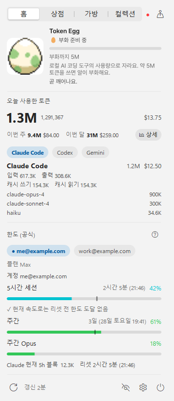
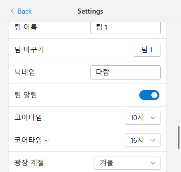

# PokeTokenBar 시작 가이드

PokeTokenBar는 Claude Code 같은 AI 코딩 도구의 토큰 사용량을 메뉴바(Windows는 트레이)에서 보여 주는 앱입니다. 쓴 만큼 알이 부화하고 포켓몬이 자랍니다. 이 문서는 사내 팀원이 설치하고 쓰기 시작하는 데 필요한 것만 담았습니다. 자세한 내용은 [TEAM.md](TEAM.md)에 있습니다.

- [Mac에 설치](#mac에-설치)
- [Windows에 설치](#windows에-설치)
- [앱 사용법](#앱-사용법)
- [팀 광장 설정](#팀-광장-설정)
- [설정 둘러보기](#설정-둘러보기)
- [자주 겪는 문제](#자주-겪는-문제)

## Mac에 설치

macOS 14 이상이면 됩니다(Apple Silicon, Intel 모두).

1. 터미널에서 설치합니다.

   ```sh
   brew install --cask likelion-campus/tap/poke-token-bar-team
   ```

2. 앱을 켜면 메뉴바에 아이콘이 생깁니다. 따로 로그인하거나 연결할 것은 없습니다. 이 Mac에 있는 Claude Code 등의 사용 기록을 앱이 직접 읽습니다.

원작(`poke-token-bar`)을 이미 쓰고 있다면 먼저 설정 → "백업 & 이전" → "세이브 내보내기"로 세이브를 보관하고, `brew uninstall --cask poke-token-bar` 로 지운 뒤 위 명령으로 설치합니다. `--zap` 은 세이브까지 지우므로 쓰지 않습니다.

Homebrew가 없으면 [릴리스 페이지](https://github.com/likelion-campus/PokeTokenBar/releases)에서 `PokeTokenBar.zip` 을 받아 `PokeTokenBar.app` 을 `/Applications` 에 넣습니다. 처음 열 때 macOS가 막으면 시스템 설정 → 개인정보 보호 및 보안 아래쪽의 "그래도 열기"를 한 번 누릅니다.

**업데이트.** 새 버전이 나오면 팝오버 위쪽에 배너가 뜹니다. "업데이트"를 누르면 앱이 꺼졌다가 새 버전으로 다시 켜집니다. zip으로 설치했다면 배너가 릴리스 페이지만 여니, 터미널에서 설치 명령 끝에 `--force` 를 붙여 한 번 실행합니다.

## Windows에 설치

Windows 11 또는 Windows 10 22H2, x64가 필요합니다. 관리자 권한은 필요 없습니다.

1. [릴리스 페이지](https://github.com/likelion-campus/PokeTokenBar/releases)에서 최신 `PokeTokenBar-Setup-<버전>-win-x64.exe` 를 받습니다.
2. 실행하면 "Windows의 PC 보호" 창이 뜹니다. 설치 파일에 코드 서명이 없어서 뜨는 창이고, "추가 정보" → "실행"을 누르면 넘어갑니다.
3. 설치 마법사(영어로 나옵니다)에서 "Next"를 눌러 끝냅니다.
4. 아이콘은 작업 표시줄 오른쪽 `^`(숨겨진 아이콘) 안에 있을 수 있습니다. 작업 표시줄로 끌어 두면 항상 보입니다.

**업데이트.** 새 버전이 있으면 트레이 메뉴와 팝오버 위쪽에 안내가 뜹니다. "업데이트"를 누르면 앱이 새 버전을 받아 설치하고 다시 켜집니다. 설정과 세이브는 그대로입니다.

**지우기.** Windows 설정 → 앱 → 설치된 앱에서 PokeTokenBar를 제거합니다. 세이브와 설정(`%LOCALAPPDATA%\PokeTokenBar`)은 남아서 다시 설치하면 이어집니다.

## 앱 사용법

평소처럼 Claude Code, Codex, Cursor 등을 쓰면 됩니다. 앱이 사용 기록을 읽어 토큰을 세고, 그 토큰이 포켓몬을 키웁니다.

메뉴바(트레이) 아이콘을 누르면 팝오버가 열립니다. Windows에서는 왼쪽 클릭이 팝오버, 오른쪽 클릭이 메뉴입니다.



| 탭 | 하는 일 |
|---|---|
| 홈 | 지금 키우는 포켓몬, 오늘·이번 주·이번 달 토큰과 비용, 최근 추이, 도구별 사용량, 공식 한도와 초기화까지 남은 시간 |
| 상점 | 그동안 쓴 토큰으로 이상한 사탕, 민트, 이로치 부적, 알을 삽니다 |
| 가방 | 가진 아이템을 씁니다. 한도를 다 채우면 이상한 사탕을 받습니다 |
| 컬렉션 | 도감과 지금까지 만난 포켓몬 기록 |

포켓몬은 이렇게 자랍니다.

1. 토큰을 쓰면 알이 부화합니다.
2. 계속 쓰면 실제 진화 순서대로 진화합니다.
3. 마지막 진화까지 다 키우면 졸업해 도감에 남고, 새 알이 옵니다.

팝오버 아래쪽 단추는 왼쪽부터 갱신, 플로팅 펫 켜고 끄기(눈 모양), 설정(톱니바퀴), 앱 끄기입니다. 플로팅 펫을 켜면 포켓몬이 바탕화면에 나와 있고, 끌어서 옮길 수 있습니다. 부화한 포켓몬을 클릭하면 팝오버가 열리고, 알을 클릭하면 기도합니다(기도는 하루에 2번까지 세고, 10번이 되면 알이 바로 부화합니다. 알이 모아 둔 토큰은 넘어가지 않습니다).

Mac에서 공식 한도는 "갱신"을 눌러야 읽습니다. 처음 누를 때 Keychain 접근을 묻는데, "항상 허용"을 고르면 다시 묻지 않습니다.

## 팀 광장 설정

팀 광장은 같은 와이파이에 있는 팀원끼리 포켓몬으로 만나는 공간입니다. 팀 기능은 기본으로 꺼져 있고, 같은 팀 코드를 넣은 사람끼리만 만납니다. Mac과 Windows 팀원이 같은 광장에서 만납니다.

설정(톱니바퀴)의 "팀" 섹션에서 합니다.



**처음 팀을 만드는 사람**

1. "팀 기능 켜기"를 켭니다.
2. "닉네임"을 정합니다(1~12자).
3. "새 팀 이름" 칸에 팀 이름(1~12자)을 넣고 "팀 만들기"를 누르면 `PTB-XXXX-XXXX-XXXX` 모양의 팀 코드가 생깁니다.
4. "코드 복사"로 복사해 팀원에게 직접 전합니다. 코드를 아는 사람은 누구나 들어올 수 있으니 공개된 곳에는 올리지 않습니다.

**코드를 받은 사람**

1. "팀 기능 켜기"를 켭니다.
2. "닉네임"을 정합니다.
3. "팀 코드 붙여 넣기" 칸에 받은 코드를 넣고 "코드로 참여"를 누릅니다. 광장이 바로 열립니다.

**처음 켤 때 묻는 권한**

- Mac: 로컬 네트워크 접근을 묻습니다. 허용해야 팀원이 보입니다. 알림 권한은 허용하지 않아도 팀 알림만 빠지고 나머지는 그대로입니다.
- Windows: 방화벽이 한 번 묻습니다. **"개인 네트워크"** 를 고릅니다.

**광장 열기.** 팀이 준비되면 팝오버 위쪽에 지도 아이콘이 생기고, 메뉴에 "광장 열기…"가 나타납니다. 광장은 직접 열 때만 뜨고, 소식이 와도 저절로 열리지 않습니다. 광장 안의 조작은 광장 화면의 안내 줄과 [TEAM.md의 조작법](TEAM.md#조작법)을 참고하세요.

**팀 섹션의 나머지 항목**

| 항목 | 하는 일 |
|---|---|
| 팀 이름 | 팀원 모두가 같이 쓰는 팀의 이름(1~12자). 누구나 바꿀 수 있고 가장 나중에 바꾼 이름이 남습니다. 광장 창 제목에 보입니다 |
| 팀 바꾸기 | 들어갔던 팀은 저장됩니다. 다른 팀을 고르면 코드를 다시 넣지 않고 옮겨 갑니다. "다른 팀 만들기·참여"로 새 팀을 추가합니다 |
| 팀 나가기 | 지금 팀을 저장 목록에서 지우고 팀 기능을 끕니다 |
| 팀 알림 | 팀원의 큰 소식(부화, 졸업 등), 나에게 온 반응, 확성기를 알림으로 받을지 정합니다 |
| 코어타임 | 광장의 낮 시간대(기본 10~16시). 앞뒤 한 시간은 노을이 지고 그 밖은 밤입니다 |
| 광장 계절 | 달력 따라 자동, 봄, 여름, 가을, 겨울 |

코어타임과 광장 계절은 팀원 누구나 바꿀 수 있고, 가장 나중에 바꾼 값을 모든 팀원이 따릅니다.

## 설정 둘러보기

설정은 팝오버 아래쪽 톱니바퀴로 엽니다.

| 섹션 | 하는 일 |
|---|---|
| 일반 | 언어, 로그인 시 자동 시작, 새로고침 간격, 대표 포켓몬, 애니메이션 품질, 한도를 쓴 양으로 볼지 남은 양으로 볼지 |
| 난이도 | 포켓몬이 자라는 속도와 상점 가격 |
| 메뉴바에 표시 | 메뉴바에 보일 숫자와 아이콘(Mac만. Windows 트레이에는 글자가 없습니다) |
| 추적할 프로바이더 | 사용량을 셀 도구(Claude Code, Codex, Cursor 등)를 고릅니다 |
| 플로팅 펫 | 바탕화면에 나오는 포켓몬을 켜고 크기를 정합니다 |
| 알림 | 한도 알림(경고, 위험 단계)과 포켓몬 소식 알림 |
| 업데이트 | 새 버전 확인 |
| 백업 & 이전 | 세이브 내보내기와 불러오기. 컴퓨터를 바꾸거나 Mac과 Windows 사이를 옮길 때 씁니다 |
| 팀 | 위 "팀 광장 설정" |
| 고급 | Claude 계정이 여러 개일 때의 설정, 사용 기록을 찾을 폴더 추가, Keychain 사용 끄기 |

## 자주 겪는 문제

**팀원이 안 보여요**

1. 모두 같은 와이파이인지, 같은 팀 코드인지 확인합니다.
2. Mac: 시스템 설정 → 개인정보 보호 및 보안 → 로컬 네트워크에서 PokeTokenBar가 켜져 있는지 확인합니다.
3. Windows: 방화벽에서 PokeTokenBar를 "개인 네트워크"로 허용했는지 확인합니다.
4. 모두 최신 버전인지 확인합니다. 버전이 다르면 새 기능이 서로 보이지 않을 수 있습니다.

**사용량이 0이에요.** 설정의 "추적할 프로바이더"에서 쓰는 도구가 켜져 있는지 확인합니다. 앱은 이 컴퓨터에서 쓴 기록만 셉니다.

**Windows에서 아이콘이 안 보여요.** 작업 표시줄 오른쪽 `^` 안을 확인합니다.

**그래도 안 되면.** Windows는 트레이 메뉴의 "로그 폴더 열기"에서 `PokeTokenBar.log` 를 찾아 함께 알려 주세요. 로그에는 팀 코드가 남지 않습니다.
